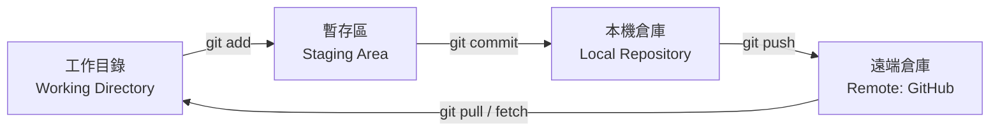

# GitHub 版本控管完整實戰指南：結合 VS Code 與 Antigravity AI

本指南旨在提供一套完整、循序漸進的操作手冊，帶領您了解如何使用 **GitHub** 建立版本控管，並利用 **Visual Studio Code (VS Code)** 視覺化介面以及 **Google Antigravity** 的 AI 協作能力，打造現代化、高效率的程式碼版本控管工作流程。

---

## 目錄 (Table of Contents)

1. [核心觀念：Git 與 GitHub 是什麼？](#1-核心觀念git-與-github-是什麼)
2. [事前準備：環境安裝與帳號設定](#2-事前準備環境安裝與帳號設定)
3. [從零開始建立 GitHub 版本控管](#3-從零開始建立-github-版本控管)
   - [情境 A：將電腦上的現有專案推送到 GitHub](#情境-a將電腦上的現有專案推送到-github)
   - [情境 B：在 GitHub 建立新 Repository 並 Clone 到本地](#情境-b在-github-建立新-repository-並-clone-到本地)
   - [防護機制：設定 `.gitignore` 避免敏感資訊外流](#防護機制設定-gitignore-避免敏感資訊外流)
4. [在 VS Code 中操作 GitHub 版本控管 (GUI 視覺化教學)](#4-在-vs-code-中操作-github-版本控管-gui-視覺化教學)
   - [VS Code 原始檔控制介面 (Source Control)](#vs-code-原始檔控制介面-source-control)
   - [綁定與登入 GitHub 帳號](#綁定與登入-github-帳號)
   - [日常基本工作流 (Stage -> Commit -> Push / Pull)](#日常基本工作流-stage---commit---push--pull)
   - [分支管理 (Branching) 與合併 (Merge)](#分支管理-branching-與合併-merge)
   - [解決程式碼衝突 (Merge Conflicts)](#解決程式碼衝突-merge-conflicts)
   - [推薦 VS Code 擴充套件](#推薦-vs-code-擴充套件)
5. [在 Antigravity 中結合 GitHub 進行 AI 智慧版本控管](#5-在-antigravity-中結合-github-進行-ai-智慧版本控管)
   - [什麼是 Antigravity？](#什麼是-antigravity)
   - [實戰工作流 1：AI 自動產生標準 Commit Message](#實戰工作流-1ai-自動產生標準-commit-message)
   - [實戰工作流 2：Pre-commit 智慧代碼審查 (Diff Review)](#實戰工作流-2pre-commit-智慧代碼審查-diff-review)
   - [實戰工作流 3：自然語言驅動 Git 操作](#實戰工作流-3自然語言驅動-git-操作)
   - [實戰工作流 4：AI 輔助解決複雜衝突 (Conflict Resolution)](#實戰工作流-4ai-輔助解決複雜衝突-conflict-resolution)
   - [實戰工作流 5：自動撰寫 Pull Request 說明與 Release Notes](#實戰工作流-5自動撰寫-pull-request-說明與-release-notes)
   - [實戰工作流 6：設定 AI 守門員規則（防止金鑰外洩）](#實戰工作流-6設定-ai-守門員規則防止金鑰外洩)
6. [常用 Git 指令速查表 (Cheat Sheet)](#6-常用-git-指令速查表-cheat-sheet)
7. [常見問題與疑難排解 (FAQ)](#7-常見問題與疑難排解-faq)

---

## 1. 核心觀念：Git 與 GitHub 是什麼？

在開始前，釐清 **Git** 與 **GitHub** 的差別至關重要：

| 項目 | Git | GitHub |
| :--- | :--- | :--- |
| **本質** | 開源的**分散式版本控管軟體 (CLI/工具)** | 以 Git 為核心的**雲端代管平台與開發者社群** |
| **運作位置** | 安裝在您的個人電腦本機端 | 託管在微軟雲端伺服器上 |
| **主要功能** | 追蹤檔案變更、記錄歷史、建立分支、合併代碼 | 遠端儲存專案、多人協同開發、Issue 追蹤、PR 審查、CI/CD 自動化 |
| **網路依賴** | 離線也能使用（本機進行 Commit、Branch 等） | 需要連上網際網路進行推送 (Push) 與同步 (Pull) |

### Git 的四大工作區域

了解 Git 的狀態流向是掌握版本控管的關鍵：



1. **Working Directory (工作目錄)**：您目前正在編輯的檔案實體。
2. **Staging Area (暫存區 / Index)**：透過 `git add` 將準備要提交的變更暫存於此。
3. **Local Repository (本機儲存庫)**：透過 `git commit` 將暫存區的變更永久記錄成本機版本歷史。
4. **Remote Repository (遠端儲存庫，如 GitHub)**：透過 `git push` 上傳至雲端，實現備份與團隊協作。

---

## 2. 事前準備：環境安裝與帳號設定

### 2.1 確認與安裝 Git
在終端機 (PowerShell 或 Command Prompt) 執行以下指令確認：
```bash
git --version
```
> 如果尚未安裝，請至 [git-scm.com](https://git-scm.com/) 下載安裝，安裝過程建議勾選「Git Credential Manager」與將 Git 加入 PATH。

### 2.2 設定本機開發者身分
安裝後，需在全域設定您的姓名與電子郵件（這會記錄在每個 commit 的作者資訊中）：
```bash
git config --global user.name "Your Name"
git config --global user.email "your_email@example.com"
```
> **Windows 使用者建議設定**：防止 Windows (CRLF) 與 Linux/macOS (LF) 換行符號造成的混淆：
```bash
git config --global core.autocrlf true
```

### 2.3 註冊 GitHub 帳號
前往 [github.com](https://github.com/) 免費註冊帳號。

---

## 3. 從零開始建立 GitHub 版本控管

### 情境 A：將電腦上的現有專案推送到 GitHub

如果您本地已經有一個寫好的專案資料夾（例如 `c:\CustomApp\HowToUseGitHubForVSCode`），想要上傳到 GitHub：

1. **進入專案資料夾並初始化 Git**：
   ```bash
   cd c:\CustomApp\HowToUseGitHubForVSCode
   git init
   ```
2. **建立 `.gitignore` 檔案**（見下方防護機制）。
3. **加入暫存區並進行第一次提交**：
   ```bash
   git add .
   git commit -m "feat: initial commit"
   ```
4. **在 GitHub 上建立新的儲存庫 (Repository)**：
   - 登入 GitHub，點擊右上角 `+` -> **New repository**。
   - 輸入儲存庫名稱（例如 `HowToUseGitHubForVSCode`）。
   - 選擇 **Public** 或 **Private**。
   - **注意**：不要勾選 "Initialize this repository with a README"（因為本地已存在專案）。
   - 點擊 **Create repository**。
5. **連結遠端倉庫並推送代碼**：
   GitHub 會提供兩行指令，在終端機執行：
   ```bash
   git branch -M main
   git remote add origin https://github.com/<您的GitHub帳號>/HowToUseGitHubForVSCode.git
   git push -u origin main
   ```
   > 系統會彈出 GitHub 登入視窗，點擊「Sign in with your browser」授權即可完成驗證。

---

### 情境 B：在 GitHub 建立新 Repository 並 Clone 到本地

如果您想先在 GitHub 上建立專案，再下載到電腦上開發：

1. 在 GitHub 建立儲存庫，勾選 **Add a README file** 與選擇對應的 `.gitignore` 模板。
2. 點擊綠色的 **Code** 按鈕，複製 HTTPS 或 SSH 連結。
3. 在本地終端機執行：
   ```bash
   git clone https://github.com/<您的GitHub帳號>/<專案名稱>.git
   cd <專案名稱>
   ```

---

### 防護機制：設定 `.gitignore` 避免敏感資訊外流

**極度重要**：絕對不能將金鑰、密碼、快取檔案或過大的相依套件庫提交到 GitHub！

請在專案根目錄建立 `.gitignore` 檔案，範例如下：

```gitignore
# 敏感資訊與環境變數
.env
.env.local
*.pem
*.key
credentials.json

# 依賴套件資料夾
node_modules/
vendor/
venv/
__pycache__/

# 編輯器與 IDE 設定檔
.vscode/*
!.vscode/settings.json
!.vscode/extensions.json
.idea/
*.swp

# 編譯產物與暫存檔
dist/
build/
*.log
npm-debug.log*

# 作業系統暫存檔
.DS_Store
Thumbs.db
```

---

## 4. 在 VS Code 中操作 GitHub 版本控管 (GUI 視覺化教學)

VS Code 內建了強大的 Git GUI 工具，讓您不必記憶繁雜指令即可完成 90% 以上的版本控管需求。

### VS Code 原始檔控制介面 (Source Control)

- **快捷鍵**：按下 <kbd>Ctrl</kbd> + <kbd>Shift</kbd> + <kbd>G</kbd>（macOS 為 <kbd>⌃</kbd> + <kbd>⇧</kbd> + <kbd>G</kbd>）。
- **介面組成**：
  - **Changes (變更)**：顯示修改過但尚未暫存的檔案。
  - **Staged Changes (暫存的變更)**：準備提交的檔案。
  - **Commit Message 輸入框**：撰寫本次修改的說明。
  - **Commit 按鈕**：提交變更。

---

### 綁定與登入 GitHub 帳號

1. 點擊 VS Code 左下角齒輪圖示旁邊的 **個人頭像帳號圖示 (Accounts)**。
2. 點選 **Sign in with GitHub to use...**。
3. 瀏覽器會自動開啟 GitHub 授權頁面，點選 **Authorize Visual Studio Code**。
4. 回到 VS Code，點選確認開啟，即可完成登入。此後 VS Code 即可直接存取您的 GitHub 儲存庫。

---

### 日常基本工作流 (Stage -> Commit -> Push / Pull)

```
檔案編輯 -> [ + ] Stage -> 填寫 Commit 訊息 -> [ Commit ] -> [ Sync Changes (Push/Pull) ]
```

1. **暫存變更 (Stage)**：
   - 滑鼠懸停在檔案名稱旁，點擊 **`+` (Stage Changes)**，該檔案會移至「Staged Changes」。
   - 若要暫存全部變更，點擊「Changes」標題旁的 **`+`**。
2. **檢視代碼差異 (Diff View)**：
   - 點擊任何一個修改過的檔案，編輯器會開啟**左右雙欄對比 (Diff)**。
   - **紅色 (左側)** 代表刪除的舊程式碼；**綠色 (右側)** 代表新增的程式碼。
3. **提交變更 (Commit)**：
   - 在訊息欄填寫清晰的說明（例如：`feat: 增加使用者登入功能`）。
   - 點擊打勾圖示或按下 <kbd>Ctrl</kbd> + <kbd>Enter</kbd> 即可完成本機提交。
4. **推送與同步 (Push / Sync)**：
   - 點擊底部的 **Sync Changes (同步變更)** 按鈕，或點擊原始檔控制面板右上角的 `...` 選擇 **Push**。
   - 代碼即會安全上傳到 GitHub！

---

### 分支管理 (Branching) 與合併 (Merge)

**分支 (Branch)** 能讓您在不影響穩定版本 (main) 的前提下開發新功能或修復 Bug。

1. **建立並切換新分支**：
   - 點擊 VS Code 左下角狀態列的分支名稱（例如 `main`）。
   - 選擇 **+ Create new branch...**。
   - 輸入分支名稱，例如 `feature/login-ui`，按 Enter。
2. **發布分支到 GitHub**：
   - 建立完成後，左下角會顯示 **Publish Branch** 按鈕，點擊即可將分支推送到 GitHub。
3. **切換分支 (Checkout)**：
   - 隨時點擊左下角分支名稱，從清單中選擇要切換的分支。
4. **合併分支 (Merge)**：
   - 切換回主要分支 `main`。
   - 開啟 Command Palette (<kbd>Ctrl</kbd> + <kbd>Shift</kbd> + <kbd>P</kbd>)，輸入 `Git: Merge Branch...`。
   - 選擇欲合併進來的分支（例如 `feature/login-ui`）。

---

### 解決程式碼衝突 (Merge Conflicts)

當多位開發者修改了同一個檔案的相同行數，合併時就會產生**衝突 (Conflict)**。

VS Code 提供了直覺的衝突解決輔助介面：

![Merge Conflict UI 示意]
```text
const apiUrl = "https://api.myapp.com/v3";
```

VS Code 會在衝突上方顯示 4 個點擊選項：
- **Accept Current Change**：保留您目前分支的代碼。
- **Accept Incoming Change**：採用外部傳入分支的代碼。
- **Accept Both Changes**：兩者都保留。
- **Compare Changes**：開啟精細對比檢視。

選好後，保存檔案，並將檔案重新加入 Stage (`git add`)，最後執行 Commit 即可完成衝突解決。

---

### 推薦 VS Code 擴充套件

在 VS Code 延伸模組市集 (<kbd>Ctrl</kbd> + <kbd>Shift</kbd> + <kbd>X</kbd>) 搜尋安裝：

1. **GitHub Pull Requests and Issues**（GitHub 官方套件）：
   - 直接在 VS Code 內檢視、建立、審查 PR 與 Issue，無需切換到網頁。
2. **GitLens — Git supercharged**：
   - 強大歷史追蹤，即時在代碼行旁顯示最後修改者、Commit 記錄與時間。
3. **Git Graph**：
   - 以色彩鮮明的美麗圖表視覺化展示分支與 Commit 歷程。

---

## 5. 在 Antigravity 中結合 GitHub 進行 AI 智慧版本控管

### 什麼是 Antigravity？

**Google Antigravity** 是一套專為 AI-First 開發打造的智慧環境與 Agent 系統。它不僅相容 VS Code 既有的外掛生態系，更進一步將 AI Agent 深度整合到開發流程中。

在版本控管場景下，Antigravity 不僅僅是「幫忙寫代碼」，更是您進行 Git 工作流的**智能副駕駛 (Copilot) 與守門員**。

---

### 實戰工作流 1：AI 自動產生標準 Commit Message

撰寫語意清晰、符合業界規範（如 Conventional Commits）的 commit message 往往耗費時間。

- **操作方式**：
  在 Antigravity 對話框或使用快速指令，輸入：
  > *「請檢視我目前的 Staged 變更，依照 Conventional Commits 規範幫我產生一則繁體中文的 Commit Message」*
- **Antigravity 輸出範例**：
  ```
  feat(auth): 新增 Google OAuth 登入流程與 Token 刷新機制

  - 實作 AuthProvider 狀態管理
  - 新增 /api/login 回呼路由處理
  - 補齊錯誤攔截與重試機制
  ```
- **效益**：省下推敲英文或格式的時間，讓團隊 Commit Log 清晰一致。

---

### 實戰工作流 2：Pre-commit 智慧代碼審查 (Diff Review)

在提交至遠端 GitHub 前，可請 Antigravity 先行做一次**預先審查 (Code Review)**，及早揪出 Bug。

- **提示詞範例**：
  > *「請審查我這次的 git diff，檢查是否有潛在的效能問題、未處理的例外、或者不小心遺留的 console.log / debug 代碼。」*
- **Agent 回饋機制**：
  Antigravity 會比對工作目錄與上一版本差異，列出需要修正的檔案與行數，甚至提供一鍵自動修復 (Auto-fix)。

---

### 實戰工作流 3：自然語言驅動 Git 操作

不用記憶冷門的 Git 參數，直接用自然語言告訴 Antigravity Agent：

| 想做的事情 | 直接對 Antigravity 說 | Agent 自動執行的底層操作 |
| :--- | :--- | :--- |
| 開發新功能 | *「幫我建一個 `feature/payment` 分支並切換過去」* | `git checkout -b feature/payment` |
| 整理未追蹤檔案 | *「幫我看哪些檔案還沒追蹤，把暫存日誌檔加入 .gitignore」* | 檢查 `git status` 並自動編輯 `.gitignore` |
| 暫存當前工作 | *「我現在要切換回 main 修急件，幫我把目前做到一半的改動暫存起來」* | `git stash save "WIP: payment logic"` |
| 還原錯誤修改 | *「我不小心改壞了 `utils.js`，幫我復原成上次 commit 的狀態」* | `git restore utils.js` |

---

### 實戰工作流 4：AI 輔助解決複雜衝突 (Conflict Resolution)

當多方合併發生嚴重衝突、程式碼結構錯綜複雜時：

1. 開啟發生衝突的檔案。
2. 選取衝突區塊或直接詢問 Antigravity：
   > *「這個檔案在合成分支時發生衝突，請幫我分析 HEAD 與 incoming 分支各自做了什麼邏輯變更，並給出正確合併兩者邏輯的代碼。」*
3. Antigravity 會理解前後文與函式呼叫關聯，產出最佳合併結果，避免傳統手動挑選時常見的語法中斷或變數遺失。

---

### 實戰工作流 5：自動撰寫 Pull Request 說明與 Release Notes

當功能完成準備推上 GitHub 提 PR 時：

- **提示詞範例**：
  > *「比對目前分支與 `origin/main` 的差異，幫我產生一份專業的 GitHub PR 描述，包含變更摘要、測試項目清單 (Checklist) 與影響範圍。」*
- **產出內容**：
  ```markdown
  ## 變更摘要 (Summary)
  本次 PR 實作了購物車結帳流程的前端驗證邏輯與結算計算。

  ## 影響範圍 (Impact)
  - `src/components/Cart.vue`
  - `src/services/payment.ts`

  ## 測試檢查清單 (Test Checklist)
  - [x] 空購物車不可點擊結帳按鈕
  - [x] 折價券折抵計算正確
  - [x] 單元測試全數通過 (npm test)
  ```

---

### 實戰工作流 6：設定 AI 守門員規則（防止金鑰外洩）

在 Antigravity 專案中的 `.agents/rules/` 設定自訂規則，讓 AI 在協助操作 Git 時自動執行安全守則：

建立檔案 `.agents/rules/git-security.md`：
```markdown
# Git 操作安全規則

1. 執行 git add 或 git commit 之前，務必檢查是否有敏感檔案（如 .env, *.pem, id_rsa, api_keys 等）。
2. 若發現敏感檔案未被 .gitignore 排除，禁止執行提交並主動警告開發者。
3. Commit 訊息一律採用繁體中文並遵循 Conventional Commits 格式。
```

---

## 6. 常用 Git 指令速查表 (Cheat Sheet)

### 倉庫初始化與狀態
```bash
git init                     # 初始化新倉庫
git status                   # 查看目前檔案狀態（紅字：未暫存；綠字：已暫存）
git log --oneline --graph    # 以簡潔單行圖表檢視提交歷史
git diff                     # 檢視尚未暫存的詳細修改
```

### 暫存與提交
```bash
git add <檔案名稱>           # 暫存單一檔案
git add .                    # 暫存當前目錄所有變更
git commit -m "訊息"         # 提交暫存區變更
git commit --amend           # 修改上一次的 commit（僅限尚未 push 前使用）
```

### 分支與合併
```bash
git branch                   # 列出所有本地分支
git branch <分支名>          # 建立新分支
git checkout <分支名>        # 切換分支（或使用 git switch <分支名>）
git checkout -b <分支名>     # 建立並直接切換至新分支
git merge <分支名>           # 將指定分支合併進當前分支
git branch -d <分支名>       # 刪除已合併的分支
```

### 遠端同步
```bash
git remote -v                # 檢視目前綁定的遠端倉庫 URL
git remote add origin <URL>  # 新增遠端倉庫
git fetch origin             # 下載遠端最新資訊但不自動合併
git pull origin <分支名>     # 下載遠端最新進度並自動合併 (fetch + merge)
git push origin <分支名>     # 將本機分支推送到 GitHub
git push -u origin <分支名>  # 首次推送並設定上游追蹤分支
```

### 復原與撤銷 (請謹慎操作)
```bash
git restore <檔案名稱>       # 放棄工作目錄中單一檔案的修改（回到上次 commit）
git restore --staged <檔案>  # 將已暫存檔案移回未暫存 (Unstage)
git stash                    # 暫存目前未提交的工作內容
git stash pop                # 取出暫存的工作內容並繼續開發
```

---

## 7. 常見問題與疑難排解 (FAQ)

### Q1: 推送時出現 `error: failed to push some refs... (fetch first)`？
- **原因**：GitHub 上的遠端儲存庫有您本機沒有的新提交（例如在網頁上編輯了 README）。
- **解法**：先拉取遠端變更合併後再推送：
  ```bash
  git pull origin main --rebase
  git push origin main
  ```

### Q2: 不小心把包含 API Key 或密碼的檔案 Commit 進去了怎麼辦？
- **若尚未 push 到 GitHub**：
  1. 將金鑰從檔案移除。
  2. 加入 `.gitignore`。
  3. 執行修正提交：
     ```bash
     git reset --soft HEAD~1
     # 重新整理檔案後再重新 commit
     ```
- **若已經 push 到 GitHub**：
  - **重要安全警報**：立即前往相關服務後台（例如 Google Cloud / AWS / OpenAI）**廢除並重新生成該 API Key**！即便刪除 Commit，歷史紀錄也可能已被爬蟲抓取。

### Q3: Git 一直提示換行符號警告 `LF will be replaced by CRLF`？
- **原因**：Windows 使用 CRLF (`\r\n`)，Linux/macOS 使用 LF (`\n`)。
- **解法**：執行以下指令讓 Git 自動轉換，不用擔心：
  ```bash
  git config --global core.autocrlf true
  ```

### Q4: 如何在 VS Code 中切換多個 GitHub 帳號？
- 點擊左下角「帳號 (Accounts)」圖示，點選「登出」，再點選「Sign in with GitHub」，即可切換至另一個 GitHub 帳號授權。

---

> 💡 **小結**：
> 掌握「**Git 基礎原理**」+「**VS Code 視覺化面板**」+「**Antigravity AI 智慧協作**」，您將擁有目前軟體開發界最現代、高效率且安全的版本控管利器！
