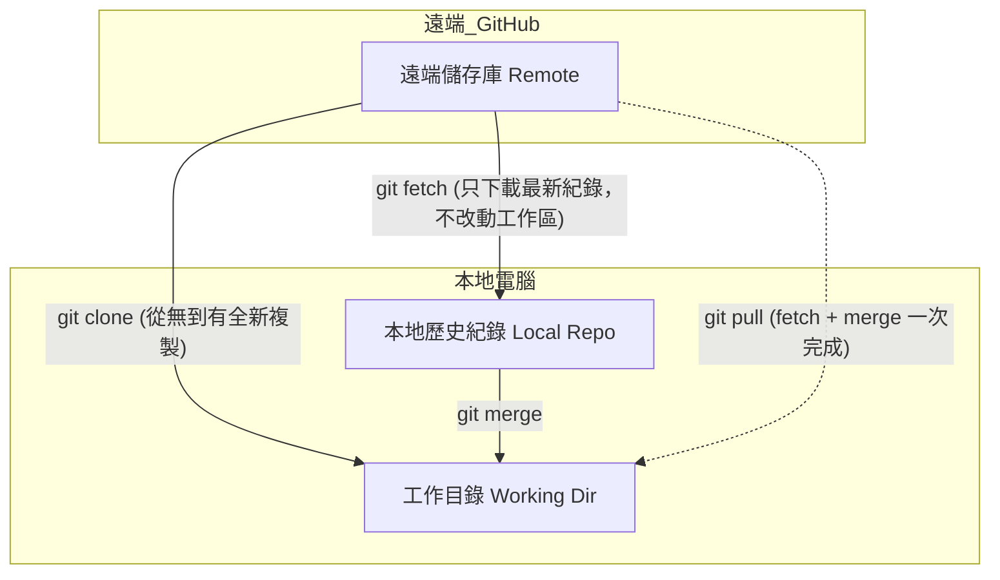

# 03 - 專案下載與雲端同步指南 (Clone, Pull, Fetch)

本篇章節說明如何從 GitHub 下載（複製 Clone）現有專案至本機電腦，以及如何在日常開發中將遠端的新進度同步（Pull / Fetch）到本地端。

---

## 目錄
1. [觀念釐清：Clone、Fetch、Pull 有何不同？](#1-觀念釐清clonefetchpull-有何不同)
2. [方式 A：使用 Git 指令複製專案 (git clone)](#2-方式-a使用-git-指令複製專案-git-clone)
3. [方式 B：在 VS Code 中圖形化 Clone 專案](#3-方式-b在-vs-code-中圖形化-clone-專案)
4. [日常雲端同步：拉取最新程式碼 (git pull)](#4-日常雲端同步拉取最新程式碼-git-pull)
5. [進階技巧：使用 git fetch 進行安全預覽](#5-進階技巧使用-git-fetch-進行安全預覽)
6. [在 VS Code 狀態列使用一鍵同步 (Sync Changes)](#6-在-vs-code-狀態列使用一鍵同步-sync-changes)

---

## 1. 觀念釐清：Clone、Fetch、Pull 有何不同？

在進行下載與同步操作時，三者的使用時機與行為完全不同：



| 指令 | 適用時機 | 行為說明 |
| :--- | :--- | :--- |
| **`git clone`** | 電腦裡**完全沒有**該專案時 | 將遠端專案整份完整下載到電腦，自動建立資料夾並設定遠端關聯。 |
| **`git fetch`** | 已經有專案，想知道遠端有哪些新更新時 | 只把遠端的新 commit 歷史下載到本機，**不會更動**您目前正在寫的檔案（非常安全）。 |
| **`git pull`** | 想把遠端的最新程式碼**直接套用**到本地工作區 | 等同於 `git fetch` + `git merge`，直接把遠端的新版本合併進您目前的檔案。 |

---

## 2. 方式 A：使用 Git 指令複製專案 (git clone)

### 2.1 取得儲存庫網址
1. 前往 GitHub 上您想要下載的專案頁面。
2. 點擊綠色的 **Code** 按鈕。
3. 選擇 **HTTPS** 頁籤，點擊右側的圖示複製 URL（例如：`https://github.com/username/project.git`）。

### 2.2 執行下載
開啟終端機，切換到您希望存放專案的母目錄（例如 `c:\CustomApp`），執行：
```bash
git clone https://github.com/username/project.git
```

Git 會自動建立一個名為 `project` 的資料夾並將所有檔案下載至其中。

若想指定不同的資料夾名稱，可以在指令後方加入自訂名稱：
```bash
git clone https://github.com/username/project.git MyNewFolder
```

進入資料夾即可開始開發：
```bash
cd project
code .   # 直接用 VS Code 開啟該專案
```

---

## 3. 方式 B：在 VS Code 中圖形化 Clone 專案

如果您不想手動開終端機，VS Code 提供了更優雅的介面：

1. 開啟 **VS Code**。
2. 在歡迎畫面點選 **Clone Git Repository... (複製 Git 儲存庫)**，或按下 <kbd>Ctrl</kbd> + <kbd>Shift</kbd> + <kbd>P</kbd> 輸入 `Git: Clone`。
3. 您可以選擇兩種方式之一：
   - **貼上 URL**：直接貼上在 GitHub 複製的 HTTPS 連結，按下 Enter。
   - **從 GitHub 挑選 (Clone from GitHub)**：若已登入 GitHub，VS Code 會列出您名下的所有儲存庫，直接點擊要下載的專案即可。
4. 選擇要將專案存放在電腦中的資料夾位置。
5. 下載完成後，VS Code 右下角會跳出提示：「Would you like to open the cloned repository?」，點擊 **Open (開啟)** 即可立刻進入工作狀態。

---

## 4. 日常雲端同步：拉取最新程式碼 (git pull)

當團隊夥伴更新了程式碼，或是您在辦公室與家中的不同電腦切換時，開始寫程式前第一件事就是**拉取最新進度**：

```bash
git pull origin main
```

- 若無任何新更新，終端機會顯示：`Already up to date.`。
- 若有更新，Git 會列出更新的檔案清單與行數增減。

> [!TIP]
> **團隊協作最佳實踐**：每天開始寫程式、或準備切換分支前，養成習慣先執行一次 `git pull`，可以大幅減少後續發生衝突的機會！

---

## 5. 進階技巧：使用 git fetch 進行安全預覽

如果您本機有尚未完成的程式碼，直接 `git pull` 可能會觸發合併衝突。這時可以先用 `fetch` 檢查：

```bash
# 1. 抓取遠端最新變更資訊（不影響您目前的檔案）
git fetch origin

# 2. 比對本地分支與遠端分支的差異
git log HEAD..origin/main --oneline

# 3. 確認無誤後，再手動合併
git merge origin/main
```

---

## 6. 在 VS Code 狀態列使用一鍵同步 (Sync Changes)

VS Code 左下角狀態列設計了非常貼心的同步小工具：

- **狀態圖示**：左下角會顯示類似 `main ↓1 ↑2` 的符號：
  - **`↓1` (Down arrow)**：代表遠端 GitHub 有 1 個新提交等待您下載 (Pull)。
  - **``↑2` (Up arrow)**：代表您本機有 2 個 commit 尚未推送到雲端 (Push)。
- **同步按鈕**：
  直接點擊左下角的**旋轉雙箭頭按鈕 (Sync Changes)**，或在「原始檔控制」面板點選 **Sync Changes**。
- VS Code 會自動以安全的方式幫您「先 Pull 遠端變更、再 Push 本地提交」，一次完成雙向同步！

---

### 下一步
- 學會專案下載與同步後，請閱讀 [04 - 分支操作與衝突解決指南](04-分支操作與衝突解決.md)，學習現代團隊必備的分支開發流程！
