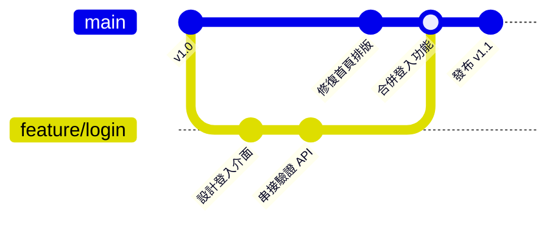

# 04 - 分支操作與衝突解決指南 (Branching & Merge Conflicts)

在現代軟體開發中，**分支 (Branch)** 是 Git 最強大也最核心的功能。它允許團隊成員在互不干擾的平行時空中開發新功能、修復 Bug，確認穩定後再合併進主分支。

---

## 目錄
1. [什麼是分支？為什麼要用分支？](#1-什麼是分支為什麼要用分支)
2. [標準分支命名規範 (Best Practices)](#2-標準分支命名規範-best-practices)
3. [分支基本操作 (指令列 CLI)](#3-分支基本操作-指令列-cli)
4. [在 VS Code 中進行圖形化分支管理](#4-在-vs-code-中進行圖形化分支管理)
5. [分支合併 (Merge) 的流程](#5-分支合併-merge-的流程)
6. [程式碼衝突 (Merge Conflicts) 的發生原因與解決步驟](#6-程式碼衝突-merge-conflicts-的發生原因與解決步驟)

---

## 1. 什麼是分支？為什麼要用分支？

預設情況下，Git 只有一條主要的發布分支（通常名為 `main` 或 `master`）。

如果所有人都在 `main` 上直接修改，一旦某個人的代碼寫壞了，所有人都會無法編譯或測試。因此，業界標準工作流為：



- **`main` 分支**：永遠保持可正常運作的穩定產品代碼。
- **功能分支 (`feature/*`)**：從 `main` 拉出獨立分支開發，開發完畢並測試通過後，再合併回 `main`。

---

## 2. 標準分支命名規範 (Best Practices)

建議團隊統一採用前綴命名規則，一眼就能看出該分支的目的：

| 前綴格式 | 用途說明 | 範例 |
| :--- | :--- | :--- |
| `feature/<功能名>` | 開發全新功能 | `feature/payment-gateway` |
| `fix/<問題名>` | 修復一般的錯誤或 Bug | `fix/header-overflow` |
| `hotfix/<緊急修復>` | 線上正式環境的重大緊急修復 | `hotfix/login-crash` |
| `docs/<文件變動>` | 撰寫或更新說明文件 | `docs/api-guide` |
| `refactor/<重構>` | 程式碼重構（不影響外部功能） | `refactor/user-service` |

---

## 3. 分支基本操作 (指令列 CLI)

### 3.1 檢視目前所有分支
```bash
git branch
```
> 目前所在的分支前方會標註星號 `*` 並以綠色顯示。

### 3.2 建立新分支
```bash
git branch feature/user-profile
```

### 3.3 切換分支
```bash
# 傳統指令
git checkout feature/user-profile

# Git 2.23+ 新版推薦指令（語意更直覺）
git switch feature/user-profile
```

### 3.4 快捷技巧：建立並立即切換至新分支
```bash
git checkout -b feature/cart
# 或新版語法
git switch -c feature/cart
```

### 3.5 將新分支推送至 GitHub (發布分支)
本機建立的分支 GitHub 上預設不存在，需要將其推送到遠端：
```bash
git push -u origin feature/cart
```

### 3.6 刪除分支
當功能已經合併完畢，不再需要該功能分支時：
```bash
# 刪除已合併的本機分支
git branch -d feature/cart

# 若想強制刪除尚未合併的分支（謹慎使用）
git branch -D feature/cart

# 刪除 GitHub 上的遠端分支
git push origin --delete feature/cart
```

---

## 4. 在 VS Code 中進行圖形化分支管理

VS Code 讓分支操作變得極為簡單：

### 4.1 檢視與切換分支
- 檢視 VS Code 視窗**左下角藍色狀態列**，會顯示目前分支名稱（如 `main`）。
- 點擊該名稱，視窗頂端會彈出分支清單，點選任一分支即可立即切換！

### 4.2 建立新分支
1. 點擊左下角分支名稱。
2. 點選 **+ Create new branch...**。
3. 輸入新分支名稱（如 `feature/login`）並按下 Enter。
4. 狀態列會自動切換為新分支。
5. 點擊左下角的 **Publish Branch (發布分支)** 按鈕，一鍵同步推送到 GitHub！

---

## 5. 分支合併 (Merge) 的流程

當在 `feature/cart` 上的功能已經完成並完成測試，要將它合併回 `main`：

### 5.1 指令列合併流程：
```bash
# 1. 先切換回要接收變更的分支（通常是 main）
git switch main

# 2. 養成好習慣：先 pull 確保本地 main 是遠端最新的
git pull origin main

# 3. 將 feature/cart 合併進 main
git merge feature/cart

# 4. 合併成功後，將更新推送到 GitHub
git push origin main
```

### 5.2 在 VS Code 中合併分支：
1. 切換至 `main` 分支。
2. 按下 <kbd>Ctrl</kbd> + <kbd>Shift</kbd> + <kbd>P</kbd> 開啟命令面板。
3. 輸入 `Git: Merge Branch...` 並按下 Enter。
4. 在清單中選擇要合併進來的分支（如 `feature/cart`）。

---

## 6. 程式碼衝突 (Merge Conflicts) 的發生原因與解決步驟

### 6.1 衝突是怎麼發生的？
當分支 A 與分支 B **修改了同一個檔案的同一個位置（相同的行數）**，Git 無法通靈決定該採用哪一邊的代碼，就會暫停合併，標記衝突點，等待人類開發者判定。

### 6.2 VS Code 衝突解決視覺化介面
當合併發生衝突時，檔案會被標示為紅色的 **`!`** 或 **`C` (Conflict)**。

點開衝突檔案，VS Code 會以醒目的顏色高亮標記衝突區塊：

```text
<<<<<<< HEAD (Current Change: 您目前分支保留的代碼)
const paymentGateway = "https://pay.stripe.com/v3";
=======
const paymentGateway = "https://pay.paypal.com/v2";
>>>>>>> feature/paypal (Incoming Change: 欲合併分支帶來的代碼)
```

在衝突文字的正上方，VS Code 貼心地提供了四個快速點擊選項：

| 選項 | 作用說明 |
| :--- | :--- |
| **Accept Current Change** | 保留您目前分支的代碼，放棄傳入的修改。 |
| **Accept Incoming Change** | 採用外部傳入分支的代碼，覆蓋掉目前分支。 |
| **Accept Both Changes** | 兩邊的代碼都保留下來（適合兩者皆需要的場景）。 |
| **Compare Changes** | 開啟左右兩欄分割畫面逐行對比。 |

> [!TIP]
> 也可以點擊右下角的 **Resolve in Merge Editor (在合併編輯器中解決)**，開啟進階的 3-way 三欄式對比檢視（左為 Current、右為 Incoming、下為最終 Result）。

### 6.3 解決衝突後的標準收尾動作：
1. 裁決完畢後，確認程式碼語法正確、沒有殘留 `<<<<<<<` 或 `>>>>>>>` 等符號。
2. 存檔檔案 (<kbd>Ctrl</kbd> + <kbd>S</kbd>)。
3. 將該檔案加入暫存區：
   ```bash
   git add <檔案名稱>
   ```
   *(或在 VS Code 原始檔控制面板中點擊檔案旁的 `+` 暫存)*
4. 完成合併 Commit：
   ```bash
   git commit -m "merge: 解決 feature/paypal 合併衝突"
   ```
5. 推送到遠端：
   ```bash
   git push origin main
   ```

---

### 下一步
- 深入掌握分支與衝突後，請閱讀 [05 - VS Code 視覺化操作指南](05-VSCode視覺化操作指南.md)，了解如何用圖形介面最大化提升日常效率！
